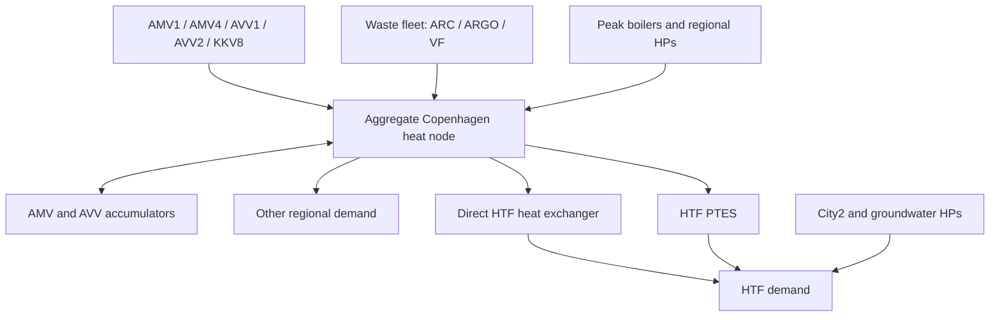

# Model formulation and interpretation

All snapshots are one hour. Powers are MW, inventories MWh, prices DKK/MWh and
the objective DKK. Capacities are fixed: there is no investment optimisation.
All producer and storage decisions are optimised, apart from measured waste heat
being used as an **availability ceiling**, not a prescribed dispatch schedule.

## Heat boundaries

Let `R` denote regional demand, `L` local HTF demand, `H` direct heat through
the heat exchanger, `C,D` PTES charging/discharging and `Q_hp` local HP heat.
The local balance is

\[
H_t+D_t+\sum_j Q_{j,t}^{hp}=L_t.
\]

The provisional default assumes regional demand includes local gross demand at
a comparable delivered-heat boundary. Consequently the upstream balance is

\[
\sum_i Q_{i,t}+Q_t^{waste}+Q_t^{boilers}+Q_t^{hp,up}
+\sum_s(D_{s,t}-C_{s,t})
=\frac{R_t-L_t+H_t+C_t}{1-\ell}.
\]

`network_loss_fraction = 0.02` is a scenario parameter. It is not established that
the public consumption series has this metering boundary. If it instead reports
net transmission withdrawals, subtracting local gross demand is invalid: obtain
historical HTF withdrawal/production data before using it as an empirical benchmark.
That interpretation is rejected by the code. The alternate explicit
`residual_excluding_htf` mode uses `R` directly as residual demand. Negative
residuals are errors, never clipped. CTR and VEKS remain separate input columns,
but share one uncongested upstream node in this first model.

Electricity coupling enters through CHP exports and HP/electric-boiler imports
valued at exogenous hourly DK2 prices. No electricity-market clearing is modelled.

## Producers

Backpressure/bypass units use a common fuel input `F` and heat-only bypass `B`:

\[
Q=P/C_m+B,\qquad F=P/\eta_{el}+B/\eta_{bypass}.
\]

Heat, electricity, bypass and fuel each have fixed capacity/availability bounds.
The same fuel capacity is shared by power production and bypass, preventing their
capacities from being added as independent plants. Efficiencies are derived from
the tabulated design points. LHV heat efficiencies above one include condensation.

Extraction units AVV1 and AVV2 use a convex production region:

\[
P+C_v Q\leq\eta_{cond}F,\qquad P\geq C_m Q.
\]

AVV2 gas-turbine/straw operating modes are not added as separate independent
capacity. Continuous availability derating (0.9 by default) is a scenario, not a
reconstructed outage schedule. CHP minimum loads, starts, ramps and individual
contract bids are omitted in this initial approximation. Thus this is not a
unit-commitment reconstruction of historical dispatch.

Waste sites are represented by one fleet, with 519.5 MW nominal heat capacity.
Hourly output is bounded by the public aggregate waste profile and that capacity.
Electricity is approximated as 0.25 times waste heat. This gives a dispatchable
upper-envelope approximation; it does not enforce waste throughput/must-take
contracts. Report the unused availability and test this simplification before
interpreting summer prices. Site names/capacities explain the fleet; no fictional
historical plant-level dispatch is inferred from the aggregate profile.

Peak boiler fuel alternatives share an aggregate heat-capacity ceiling, preventing
the total dual-fuel capacity from being counted twice at system level. This remains
coarser than individual boiler fuel-sharing constraints. Fuel efficiency, variable
cost and grid adders are scenario inputs. Regional HP capacity/COP are assumptions.

## Storage and local heat pumps

For every store, end-of-hour inventory satisfies

\[
E_t=(1-\lambda)E_{t-1}+\eta_c C_t-D_t/\eta_d.
\]

Each has a fixed initial and terminal inventory, including regional accumulators.
The PTES defaults to 3300 MWh and an effective 23 MW charge/discharge scenario;
30 MW is a required design-capacity sensitivity. Separate binary modes enforce
10 MW minimum charging, 5 MW minimum discharging, no simultaneous flows, 12 MW/h
ramps and no reversal in the next two hours. Initial flow is assumed zero; ramps
apply from that point. No cyclic mode/ramp connection across the year boundary is
assumed. The horizon ends with free final flow but fixed energy, so test endpoint
effects. `H+C <= 100 MW` is an assumed shared HTF connection; `H >= 0.5 MW` is
an aggregate warm-keeping approximation, not a surveyed network constraint.

Regional accumulators use continuous flow variables and `C+D <= power capacity`.
Their simultaneous charging/discharging is a relaxation and must be reported.
The default hourly PTES loss 0.000275 is provisional; it is not a fitted result.
Pumping defaults to zero because a verified coefficient is missing; sensitivity
values must be explicitly identified as assumptions, not measured pumping energy.

Each local HP obeys `0 <= Q <= thermal_capacity` and `P_el = Q/COP_t`; changing COP
cannot increase its thermal output ceiling. Binary HP modes implement 25% minimum
load, two-hour minimum up/down times, startup costs and an initially off condition.
Starts/stops too close to the end to fulfil their duration are forbidden. No
unverified compressor electrical rating is invented. `heat_pumps.policy: must_run`
instead enforces full thermal output, for comparison with stakeholder practice.

## Objectives and settlements

The coordinated objective minimises fuel costs, variable O&M, electricity imports
and starts, less electricity sales. It includes scenario fiscal/grid adders. It is
**net operating expenditure**, not a pure social resource-cost or welfare measure.
Heat payments and tariff credits are transfers and do not enter this objective.
Negative net heat cost can arise when electricity revenue offsets operating costs.

Under the default `discharge_service` local settlement, the HTF objective is

\[
\min\sum_t [\tau_t H_t+(\tau_t-\delta_t)D_t
+(\pi_t+a)(P_t^{hp}+P_t^{pump,dis})]+\text{HP startup costs}.
\]

Charging follows an explicitly supplied central schedule, with the same inventory
endpoints. HTF does not buy charging heat in this boundary. Direct delivery retains
the monthly reference tariff; the discharge discount `delta` is the experiment
parameter. Supplier local heat revenue is the corresponding heat payment minus
the discharge credit; it is not supplier profit. Contracts and pumping allocation
still need confirmation. The optional `legacy_owned_store` mode instead bills
`tau*(H+C)-delta*D` and allocates both storage pumping flows locally. Results from
these settlement boundaries must not be pooled.

The local problem does not include upstream redispatch after a deviation. It is
therefore an intermediate response benchmark, not completion of the paper's five
step soft-coupling workflow. Deviation penalties, behavioural preferences, iterative
feedback and a justified tariff formula remain future work.

## Marginal values

`--prices` first solves dispatch, then fixes every integer decision and resolves a
continuous LP. Regional heat-balance duals are conditional upstream values. They
exclude the cost of changing commitment and are not automatically an implementable
tariff. With delivered demand and the above loss convention, the demand derivative
is the upstream dual divided by `1-ell`. A finite-difference test checks this sign
and scaling. Raw MILP duals are never used as prices.
